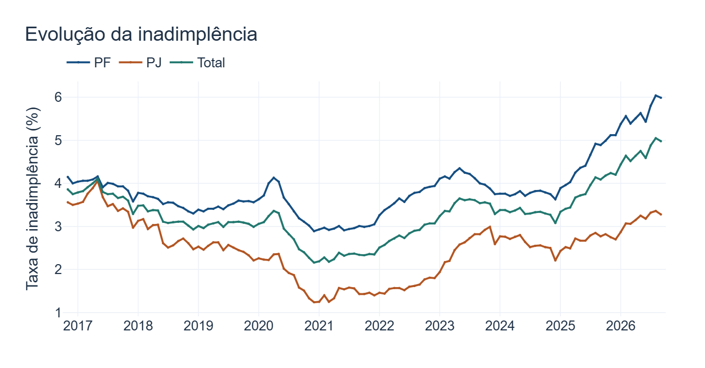
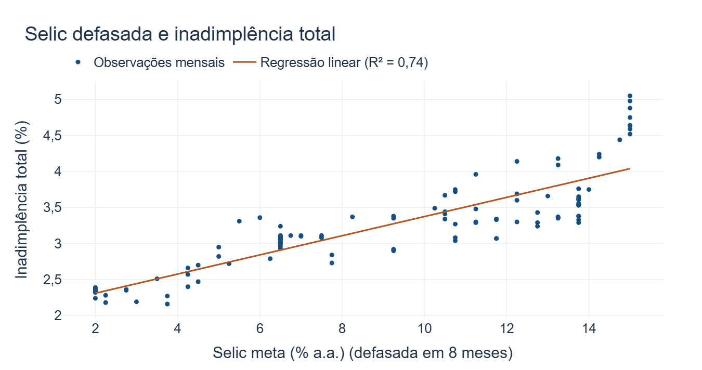
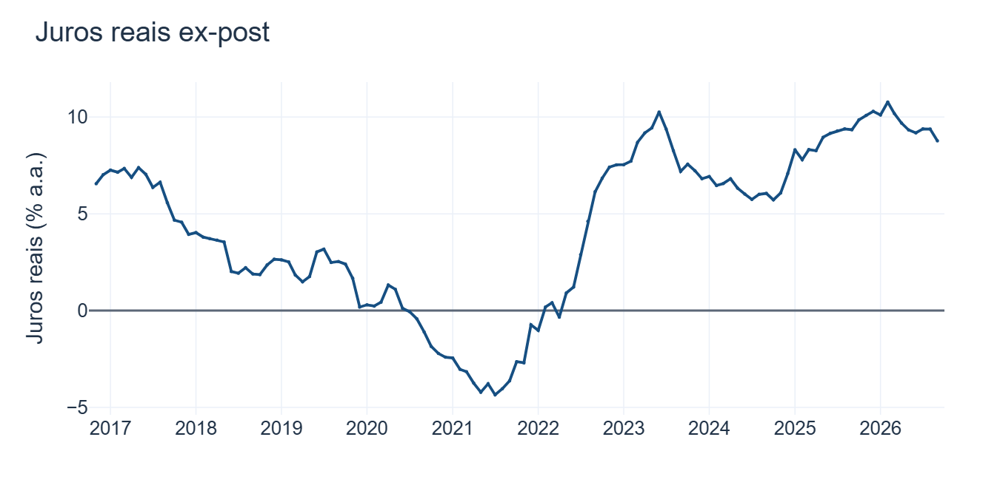

Projeto da disciplina de **Programação Orientada a Objetos**, do curso de **Ciência de Dados e Inteligência Artificial** da PUC-SP. O RadarCrédito reúne séries do Banco Central do Brasil em um painel interativo feito com Python, Pandas, Plotly e Streamlit.

[Abrir o painel no Streamlit](https://radar-credito-9bkrsgposq2fxw9fxmappcm.streamlit.app/) · [Ver o repositório no GitHub](https://github.com/Pau7027/radar-credito)

**Guia técnico** · [Tratamento e análise](#metodologia) · [Arquitetura e classes](#arquitetura-poo) · [Polimorfismo](#polimorfismo) · [SOLID](#solid) · [Indicadores](#indicadores-do-painel)

## Integrantes

| Nº | Nome completo | RA |
| --- | --- | --- |
| 1 | Paulo Enrique Pérez González | 00370839 |
| 2 | Thiago Laurino Silva | 00372259 |
| 3 | Giovana Lordello Guimarães | 00376042 |
| 4 | Gabriel Sousa de Carvalho | 00369956 |
| 5 | Julia Amy Yoshioka | 00370507 |

## Justificativa e objetivos

A inadimplência indica que parte do crédito concedido está com pagamentos atrasados. A taxa total do país pode esconder movimentos diferentes entre famílias e empresas e entre modalidades como o cartão de crédito e o cheque especial. Escolhemos esse tema porque as séries públicas do Banco Central permitem acompanhar essas diferenças ao longo do tempo e investigar sua relação com juros e inflação.

A análise investiga cinco perguntas.

1. Como a inadimplência evoluiu e quando ocorreram os principais picos e vales?
2. Qual modalidade de pessoa física apresentou a maior inadimplência e a maior volatilidade?
3. Altas da Selic antecederam altas da inadimplência? Com quantos meses de defasagem?
4. Como os juros reais e o IPCA se associaram à inadimplência? Qual explicou mais da variação observada na amostra?
5. Pessoas físicas e jurídicas acompanharam o mesmo ciclo?

## Fonte pública e variáveis

Os dados vêm da API do **Sistema Gerenciador de Séries Temporais (SGS)** do Banco Central do Brasil. As séries de crédito medem o percentual do saldo da carteira do Sistema Financeiro Nacional em operações com pelo menos uma parcela em atraso há mais de 90 dias. O aplicativo consulta o intervalo de novembro de 2016 a outubro de 2026. A amostra de crédito usada nos gráficos desta página tem **119 meses**, de novembro de 2016 a setembro de 2026. As séries macroeconômicas começam em novembro de 2015 para dar histórico ao cálculo da inflação acumulada.

| Código SGS | Série | Frequência e unidade |
| --- | --- | --- |
| 21082 | Inadimplência total | Mensal, % da carteira |
| 21083 | Inadimplência de pessoas jurídicas (PJ) | Mensal, % da carteira |
| 21084 | Inadimplência de pessoas físicas (PF) | Mensal, % da carteira |
| 21112 | Inadimplência de PF com recursos livres | Mensal, % da carteira |
| 21113 | Inadimplência de PF no cheque especial | Mensal, % da carteira |
| 21129 | Inadimplência de PF no cartão de crédito | Mensal, % da carteira |
| 21145 | Inadimplência de PF com recursos direcionados | Mensal, % da carteira |
| 432 | Meta da taxa Selic | Diária, % ao ano |
| 433 | Variação do IPCA | Mensal, % no mês |

No formato longo, `data` indica a data de referência, `modalidade` identifica a série e `valor` registra a taxa em escala percentual. Um valor de `5.2` corresponde a **5,2%**. Diferenças entre taxas são expressas em pontos percentuais (p.p.). Nas correlações, os dados ficam em formato largo, com uma linha por mês e uma coluna por série.

<a id="metodologia"></a>

## Tratamento e análise dos dados

### 1. Consulta ao SGS e normalização

`FonteBCB.obter_serie()` recebe um código SGS e um intervalo. A consulta é dividida em blocos de até cinco anos para limitar o tamanho de cada requisição, sobretudo para a Selic diária. Para cada série, a classe reúne as respostas, remove datas repetidas e ordena os registros. A conversão abaixo permite ordenar e filtrar datas cronologicamente, além de calcular sobre valores numéricos. `errors="coerce"` representa um valor ilegível como `NaN`, preservando a diferença entre valor ausente e taxa igual a zero. [Conversão e ordenação em `fonte_dados.py`](https://github.com/Pau7027/radar-credito/blob/main/src/fonte_dados.py#L88-L144)

```python
tabela = pd.DataFrame(dados)
tabela["data"] = pd.to_datetime(tabela["data"], format="%d/%m/%Y")
tabela["valor"] = pd.to_numeric(tabela["valor"], errors="coerce")
```

Uma consulta bem-sucedida atualiza o CSV da série. Em caso de falha tratada pela classe, `obter_serie()` tenta ler o CSV e devolve as observações disponíveis no intervalo pedido. Isso permite usar o painel com os dados já disponíveis no repositório quando o SGS está indisponível. O Streamlit também guarda o resultado das funções de carregamento por até uma hora, o que reduz consultas repetidas ao interagir com a interface. [Consulta e alternativa em CSV](https://github.com/Pau7027/radar-credito/blob/main/src/fonte_dados.py#L71-L84) · [Cache do Streamlit](https://github.com/Pau7027/radar-credito/blob/main/streamlit_app.py#L39-L65)

### 2. Diagnóstico de qualidade e exploração

O notebook verifica, por série, a presença de valores ausentes, datas duplicadas, meses faltantes e taxas fora de 0% a 100%. Contar registros, por si só, não identifica lacunas. O código monta um calendário mensal esperado com `freq="MS"` e verifica se cada mês está presente. [Notebook de exploração inicial](https://github.com/Pau7027/radar-credito/blob/main/notebooks/01_exploracao_inicial.ipynb)

```python
menor_data = df["data"].min()
maior_data = df["data"].max()
datas_esperadas = pd.date_range(start=menor_data, end=maior_data, freq="MS")
datas_presentes = set(df["data"])
faltantes = []
for data in datas_esperadas:
    if data not in datas_presentes:
        faltantes.append(data.strftime("%Y-%m-%d"))
```

Na amostra versionada, as sete séries de crédito têm 119 meses consecutivos, sem valores ausentes, duplicidades de data ou taxas fora dos limites. O notebook sinaliza valores extremos pelo intervalo interquartil e mantém essas observações na amostra. Um valor extremo pode registrar uma mudança real na série. Em seguida, média, mediana e desvio padrão descrevem o nível e a dispersão. `idxmin()` e `idxmax()` localizam as datas dos vales e picos. O coeficiente de variação, calculado como desvio padrão dividido pela média, permite comparar a dispersão relativa de séries com níveis diferentes.

### 3. Formato longo, formato largo e alinhamento mensal

`carregar_dados()` atribui o nome da modalidade a cada série e concatena as tabelas no formato longo. Assim, o painel filtra datas e modalidades na mesma estrutura, e os gráficos de linha usam a coluna `modalidade` para distinguir as séries. Para calcular correlações, `Dashboard._tabela_larga()` usa `pivot_table()` para transformar cada modalidade em uma coluna, com uma linha por data. Se houver mais de um valor para a mesma combinação de data e modalidade, o pivô usa a média. [Montagem da tabela de crédito](https://github.com/Pau7027/radar-credito/blob/main/streamlit_app.py#L40-L53) · [Conversão para formato largo](https://github.com/Pau7027/radar-credito/blob/main/src/dashboard.py#L629-L643)

```python
tabela = dados.pivot_table(
    index=coluna_data,
    columns=coluna_modalidade,
    values=coluna_valor,
    aggfunc="mean",
)
```

O IPCA e as taxas de crédito são mensais. Para alinhar a meta Selic diária, `agregar_mensal()` ordena as datas, agrupa os registros por mês e usa o último valor disponível como referência de fim do mês. O resultado recebe a data do primeiro dia do mês como chave, seguindo a convenção das outras séries mensais. [Agregação mensal em `analisador.py`](https://github.com/Pau7027/radar-credito/blob/main/src/analisador.py#L163-L183)

```python
serie = tabela.set_index("data")["valor"].sort_index()
grupos = serie.groupby(serie.index.to_period("M"))
if operacao == "ultimo":
    resultado = grupos.last()
else:
    resultado = grupos.mean()
resultado.index = resultado.index.to_timestamp()
```

No carregamento, `unir_series()` reúne Selic e IPCA com uma junção externa, preservando as datas disponíveis em qualquer uma das duas séries. Para o mapa de calor, `_juntar_macro()` faz uma junção à esquerda com o índice da tabela de crédito filtrada. Assim, o recorte de crédito define os meses da matriz, e meses sem um valor macroeconômico permanecem ausentes. [Junção de Selic e IPCA](https://github.com/Pau7027/radar-credito/blob/main/src/analisador.py#L138-L161) · [Junção com o recorte de crédito](https://github.com/Pau7027/radar-credito/blob/main/src/dashboard.py#L574-L582)

### 4. Agregação e análise estatística

**Ranking e treemap.** Após os filtros, `Visualizador._media_por_modalidade()` agrupa os registros e calcula a média aritmética das taxas mensais válidas de cada modalidade. Cada mês válido tem o mesmo peso nessa média. As barras comparam os níveis médios e o treemap usa a proporção entre esses níveis para definir as áreas. Para calcular uma taxa ponderada pelo saldo, seriam necessários os volumes de crédito. [Agrupamento usado nos dois gráficos](https://github.com/Pau7027/radar-credito/blob/main/src/visualizador.py#L95-L108)

```python
agrupado = (
    tabela.groupby(coluna_modalidade, as_index=False)[coluna_valor]
    .mean()
    .sort_values(coluna_valor, ascending=False)
)
```

**Mapa de calor.** `tabela_calculo.corr(method="pearson")` mede a associação linear entre cada par de colunas no mesmo mês. O Pandas usa os meses em que as duas séries do par têm valores válidos. A matriz reúne crédito, meta Selic e IPCA mensal, de modo que o IPCA de cada célula representa a variação do mês. [Cálculo da matriz](https://github.com/Pau7027/radar-credito/blob/main/src/visualizador.py#L418-L450)

**Defasagem e dispersão.** O painel alinha a Selic e a série de referência por data e remove as linhas sem o par de valores antes de chamar `DefasagemOtima`. Para cada deslocamento de 0 a 24, `shift(k)` muda a posição dos valores da Selic e a classe calcula Pearson nos pares restantes. Com a amostra mensal contínua, oito posições correspondem a oito meses. Se o recorte tiver meses ausentes, o deslocamento opera sobre as observações disponíveis, por isso essa equivalência depende da continuidade. [Montagem das séries pareadas](https://github.com/Pau7027/radar-credito/blob/main/src/dashboard.py#L423-L450) · [Busca da defasagem](https://github.com/Pau7027/radar-credito/blob/main/src/indicadores.py#L392-L435)

```python
for k in range(self._defasagem_maxima + 1):
    selic_defasada = self._selic.shift(k)
    tabela_par = pd.DataFrame(
        {"selic": selic_defasada, "inadimplencia": self._inadimplencia}
    ).dropna()
    # O restante do laço valida os pares e calcula a correlação.
```

A busca exige pelo menos três pares e variabilidade nas duas séries. A maior magnitude (`abs(r)`) define a defasagem escolhida, mantendo o sinal original de `r` no resultado. No gráfico, o controle permite testar outra defasagem e `np.polyfit(x_arr, y_arr, 1)` ajusta a reta aos pares exibidos. O R² mede o ajuste da reta na amostra. Séries com tendências em comum e a busca por vários deslocamentos podem aumentar a associação observada. [Ajuste da reta e cálculo do R²](https://github.com/Pau7027/radar-credito/blob/main/src/visualizador.py#L170-L209)

<a id="arquitetura-poo"></a>

## Arquitetura orientada a objetos

`streamlit_app.py` é o ponto de entrada e o local de montagem do aplicativo. Ele chama as rotinas de carregamento, instancia o analisador e registra as classes de indicador. Em seguida, passa esses componentes ao `Dashboard`. Quando o usuário altera os filtros, o painel pede ao analisador o recorte, usa os indicadores para calcular as métricas, solicita ao visualizador as figuras e exibe as leituras da análise interpretativa. [Montagem em `streamlit_app.py`](https://github.com/Pau7027/radar-credito/blob/main/streamlit_app.py#L68-L100) · [Fluxo de renderização](https://github.com/Pau7027/radar-credito/blob/main/src/dashboard.py#L158-L165)

```python
dashboard = Dashboard(
    analisador=analisador,
    indicadores=indicadores,
    visualizador=Visualizador(),
    titulo="RadarCrédito",
    descricao=descricao,
    series_folha=SERIES_FOLHA,
    series_macro=series_macro,
    analise=AnaliseInterpretativa(),
)

dashboard.renderizar()
```

O construtor recebe objetos para análise, visualização e interpretação, além do dicionário de **classes** dos indicadores. O painel instancia essas classes depois de conhecer a série de referência. A composição permite que a tela use uma tabela ou um visualizador fornecido pelo ponto de entrada. A requisição HTTP e o cache de disco permanecem sob responsabilidade de `FonteBCB`.

### Classes e suas responsabilidades

| Classe | Responsabilidade e métodos relevantes |
| --- | --- |
| [`FonteDados`](https://github.com/Pau7027/radar-credito/blob/main/src/fonte_dados.py#L18-L33) | Classe abstrata de coleta. Define `obter_serie(codigo, data_inicio, data_fim)`, cujo resultado é uma tabela com `data` e `valor`. |
| [`FonteBCB`](https://github.com/Pau7027/radar-credito/blob/main/src/fonte_dados.py#L36) | Implementa `obter_serie()` para o SGS. Realiza a requisição, converte a resposta, consolida os blocos e gerencia o CSV de cada série. |
| [`ErroFonteDados`](https://github.com/Pau7027/radar-credito/blob/main/src/fonte_dados.py#L12-L15) | Exceção usada pela coleta em situações como resposta sem dados ou indisponibilidade de um CSV de cache. |
| [`AnalisadorDados`](https://github.com/Pau7027/radar-credito/blob/main/src/analisador.py#L16) | Guarda o DataFrame de crédito. `filtrar()` recorta as séries e as datas. `agregar_mensal()` e `unir_series()` preparam as séries macroeconômicas. Também oferece agrupamentos e estatísticas descritivas. |
| [`Indicador`](https://github.com/Pau7027/radar-credito/blob/main/src/indicadores.py#L12) | Classe abstrata dos indicadores. Define `calcular()`, centraliza a validação das séries e fornece nome, descrição e unidade por `descrever()`. |
| [`Visualizador`](https://github.com/Pau7027/radar-credito/blob/main/src/visualizador.py#L14) | Recebe tabelas e produz figuras Plotly. Prepara os valores para linhas, barras, treemap, mapa de calor e dispersão. |
| [`AnaliseInterpretativa`](https://github.com/Pau7027/radar-credito/blob/main/src/analise_interpretativa.py#L119) | Reúne as conclusões da amostra completa e gera resumos dinâmicos, como picos e vales do período filtrado, por `resumo_evolucao()`. |
| [`Dashboard`](https://github.com/Pau7027/radar-credito/blob/main/src/dashboard.py#L12) | Coordena os filtros, o cálculo dos cartões e a renderização das abas no Streamlit. Também prepara as tabelas que cada gráfico consome. |

### Abstração, herança e encapsulamento

`FonteDados` é uma classe abstrata. Seu método `obter_serie()` descreve a entrada e o formato de saída esperados. `FonteBCB(FonteDados)` herda esse contrato e o implementa com requisições ao SGS e leitura de CSV. Isso permite discutir o contrato da coleta independentemente dos detalhes de HTTP. [Contrato e implementação de coleta](https://github.com/Pau7027/radar-credito/blob/main/src/fonte_dados.py#L18-L84)

No analisador, o construtor guarda `dados.copy()` em `_dados` e a propriedade pública devolve outra cópia. Essa escolha protege a tabela interna de alterações feitas por quem a consulta. Métodos como `filtrar()` também trabalham com cópias, permitindo montar recortes para gráficos sem alterar o conjunto de dados do analisador. [Cópias no construtor, na propriedade e no filtro](https://github.com/Pau7027/radar-credito/blob/main/src/analisador.py#L19-L80)

```python
@property
def dados(self) -> pd.DataFrame:
    """Cópia do DataFrame interno."""
    return self._dados.copy()
```

<a id="polimorfismo"></a>

### Onde está o polimorfismo

O exemplo executado no painel está em `Dashboard._renderizar_kpis()` e `Dashboard._valor_do_indicador()`. O dicionário abaixo, definido no ponto de entrada, associa o rótulo de cada cartão a uma classe concreta. [Registro das classes](https://github.com/Pau7027/radar-credito/blob/main/streamlit_app.py#L73-L79)

```python
indicadores = {
    "Variação vs. média de 12 meses": VariacaoVsMedia12m,
    "Volatilidade (12 meses)": Volatilidade12m,
    "Z-score": ZScore,
}
```

O laço percorre as entradas de `self._indicadores` e passa cada classe a `_valor_do_indicador()`. Nesse método, `classe(serie_historica)` cria a instância, e Python resolve `calcular()` de acordo com o tipo do objeto em tempo de execução. O mesmo trecho executa uma média móvel, um desvio padrão móvel ou uma padronização, conforme a classe selecionada. O painel usa `descrever()` para obter a unidade e a explicação do resultado. [Laço que renderiza os cartões](https://github.com/Pau7027/radar-credito/blob/main/src/dashboard.py#L301-L307) · [Chamada polimórfica e leitura do resultado](https://github.com/Pau7027/radar-credito/blob/main/src/dashboard.py#L233-L262)

```python
indicador = classe(serie_historica)
resultado = indicador.calcular()
```

Por exemplo, a mesma chamada `calcular()` executa estes dois métodos. A escolha de `shift(1)` na primeira fórmula exclui o mês atual da média de comparação. Na segunda fórmula, a janela de volatilidade inclui o mês atual. [Implementações em `indicadores.py`](https://github.com/Pau7027/radar-credito/blob/main/src/indicadores.py#L123-L170)

```python
# VariacaoVsMedia12m
def calcular(self) -> pd.Series:
    """Calcula a variação mensal em relação à média móvel defasada de 12 meses."""
    media_movel_12m = self._serie.rolling(12).mean().shift(1)
    return self._serie - media_movel_12m
```

```python
# Volatilidade12m
def calcular(self) -> pd.Series:
    """Calcula o desvio padrão amostral móvel em janela de 12 meses."""
    return self._serie.rolling(12).std()
```

<a id="solid"></a>

### Onde entram os princípios SOLID

| Princípio | Evidência no RadarCrédito e alcance da aplicação |
| --- | --- |
| **S — Responsabilidade única** | `FonteBCB` lida com alterações no SGS, `Indicador` e suas subclasses lidam com as fórmulas, e `Dashboard` coordena a interface. Alterar a fórmula da volatilidade, por exemplo, exige mexer em `Volatilidade12m`. O dashboard também prepara algumas tabelas específicas da tela. |
| **O — Aberto para extensão, fechado para modificação** | O laço dos cartões atende a novas classes compatíveis cadastradas no dicionário de `streamlit_app.py`. A extensão muda a configuração e reaproveita `_renderizar_kpis()`. Os gráficos macroeconômicos têm integração própria. |
| **L — Substituição de Liskov** | `VariacaoVsMedia12m`, `Volatilidade12m` e `ZScore` podem ocupar a mesma posição no laço. As três aceitam uma única `pd.Series` temporal e produzem outra `pd.Series`. Esse é o contrato do consumidor dos cartões. `JurosReais` exige duas séries, e `DefasagemOtima` exige duas séries e retorna uma tabela. Essas classes atendem ao contrato mais geral de `Indicador` e têm pontos de chamada próprios. |
| **I — Segregação de interfaces** | Os contratos abstratos são pequenos e voltados a operações distintas. `FonteDados` exige `obter_serie()` e `Indicador` exige `calcular()`. Uma fonte implementa coleta e um indicador implementa cálculo. O projeto usa classes concretas para os demais componentes do painel. |
| **D — Inversão de dependência** | Nos cartões, o painel opera sobre o contrato de `Indicador` e recebe as subclasses externamente. A injeção pelo construtor também desloca a montagem de `AnalisadorDados`, `Visualizador` e `AnaliseInterpretativa` para o ponto de entrada. A aplicação é parcial porque o painel mantém dependências concretas, inclusive nas chamadas a `JurosReais` e `DefasagemOtima`. |

[Construtor e validação dos indicadores](https://github.com/Pau7027/radar-credito/blob/main/src/dashboard.py#L28-L112) · [Contrato `Indicador`](https://github.com/Pau7027/radar-credito/blob/main/src/indicadores.py#L57-L78) · [Uso de `JurosReais`](https://github.com/Pau7027/radar-credito/blob/main/src/dashboard.py#L585-L601)

<a id="indicadores-do-painel"></a>

## Indicadores desenvolvidos

| Indicador | Cálculo e unidade |
| --- | --- |
| Inadimplência no fim do período | Última taxa disponível até a data final, em %. O cartão mostra a diferença para a observação anterior em p.p. |
| Variação em relação à média de 12 meses | `VariacaoVsMedia12m` subtrai da taxa do mês a média dos 12 meses anteriores. Resultado em p.p. |
| Volatilidade de 12 meses | `Volatilidade12m` calcula o desvio padrão amostral dos últimos 12 meses, incluindo o mês de referência. Resultado em p.p. |
| Z-score histórico | `ZScore` mede a distância da taxa à média do histórico, em desvios padrão. |
| Juros reais ex-post | `JurosReais` aplica a equação de Fisher à meta Selic de fim de mês e ao IPCA acumulado em 12 meses. Resultado em % ao ano. |
| Defasagem da Selic | `DefasagemOtima` testa deslocamentos de 0 a 24 meses e seleciona o que maximiza o valor absoluto da correlação de Pearson. Resultado em meses, acompanhado pelo coeficiente com seu sinal. |

### Histórico usado nos cartões

O primeiro cartão é calculado pelo próprio `Dashboard`. Para os outros três, o painel calcula sobre o histórico disponível da série de referência e mostra o último resultado válido até a data final escolhida. Isso permite usar meses anteriores ao início do recorte para preencher uma janela de 12 meses. O `ZScore` sem janela usa a média e o desvio padrão de todo o histórico carregado. Assim, ao selecionar uma data final no passado, a referência do z-score pode incluir meses posteriores, como é esperado de uma leitura retrospectiva. [Seleção do valor exibido](https://github.com/Pau7027/radar-credito/blob/main/src/dashboard.py#L221-L292) · [Implementação de `ZScore`](https://github.com/Pau7027/radar-credito/blob/main/src/indicadores.py#L198-L233)

### Inflação acumulada e juros reais

Para acumular o IPCA, `JurosReais` multiplica 12 fatores mensais `1 + IPCA / 100` e subtrai 1 do produto. A multiplicação representa a composição das variações mensais, inclusive quando há deflação. A Selic entra no cálculo como fator nominal e o IPCA acumulado, como fator de inflação. O resultado volta à escala percentual anual. A coleta das séries macroeconômicas começa um ano antes da de crédito para fornecer a janela inicial de inflação. [Cálculo em `JurosReais.calcular()`](https://github.com/Pau7027/radar-credito/blob/main/src/indicadores.py#L284-L307)

```python
fator_nominal = 1.0 + tabela["selic"] / 100.0
fator_inflacao = 1.0 + tabela["ipca_12m"]
juros_reais = (fator_nominal / fator_inflacao - 1.0) * 100.0
```

## Gráficos e interpretação

As figuras abaixo foram geradas com os dados versionados. Use o painel Streamlit para explorar recortes diferentes e consultar os valores de cada ponto.

### Evolução da inadimplência



A taxa total caiu de **3,86%** em novembro de 2016 para **2,16%** em dezembro de 2020 e alcançou **5,05%** em agosto de 2026. PF e PJ registraram os seus mínimos em dezembro de 2020. A alta que se seguiu foi mais intensa na carteira de pessoas físicas.

### Ranking das modalidades


O **cheque especial** teve a maior taxa média (13,69%) e o maior desvio padrão histórico em pontos percentuais (1,99 p.p.). Cartão de crédito ficou em segundo lugar na média (6,97%), seguido de recursos direcionados (1,84%). Quando a volatilidade é medida em relação à própria média, os recursos direcionados lideram entre as três modalidades.

### Comparação em treemap


O cheque especial ocupa cerca de 61% da área porque sua taxa média representa essa proporção da soma das três taxas usadas no desenho. As áreas comparam os níveis de inadimplência das modalidades. Uma interpretação em termos de participação na carteira exigiria dados de volume de crédito.

### Mapa de calor de correlações


A correlação no mesmo mês entre inadimplência total e de pessoas físicas foi **0,94**. A taxa de PF faz parte do total, contribuindo para esse resultado. A correlação entre PF e PJ foi **0,60**, compatível com um ciclo em parte comum e trajetórias de intensidades diferentes.

### Dispersão com defasagem da Selic



Cada ponto compara a inadimplência total de um mês à meta Selic observada oito meses antes. Entre as defasagens testadas na amostra, essa produziu a maior correlação para o total (**r = 0,86**, **R² = 0,74**). A defasagem de maior correlação foi de seis meses para PF e 14 para PJ.

### Evolução dos juros reais



Os juros reais ficaram negativos em parte de 2020 a 2022 e atingiram **10,78% ao ano** em fevereiro de 2026. Na comparação de regressões simples da análise interpretativa, os juros reais defasados em seis meses tiveram maior poder explicativo na amostra para inadimplência total (**R² = 0,75**) que o IPCA acumulado em 12 meses (**R² = 0,17**).

## Como usar o dashboard

1. Abra o [RadarCrédito no Streamlit](https://radar-credito-9bkrsgposq2fxw9fxmappcm.streamlit.app/) e escolha o intervalo de datas e as séries na barra lateral.
2. Escolha a série de referência no topo. O primeiro cartão mostra a taxa no fim do período e a variação mensal quando disponível. Os outros três mostram a variação ante a média de 12 meses, a volatilidade e o z-score.
3. Abra **Evolução** para localizar picos e vales. Use **Comparação** para ver as médias por modalidade em barras e treemap.
4. Use **Correlações** para ler a matriz, ajustar a defasagem da Selic e visualizar a série de juros reais.
5. Em **Análise e conclusões**, consulte as respostas às perguntas do projeto. Em **Tabela de dados**, veja as datas, séries e taxas do recorte selecionado.

Os gráficos, os cartões e os resumos do período selecionado acompanham os filtros. As leituras identificadas pelo recorte de novembro de 2016 a setembro de 2026 descrevem a amostra completa.

## Conclusões e limitações

A inadimplência total seguiu uma trajetória de queda e alta, com a aceleração final mais intensa em PF. O cheque especial apresentou a maior inadimplência média e a maior volatilidade em pontos percentuais entre as modalidades comparadas. Selic e juros reais tiveram associação positiva com a inadimplência total na amostra. As diferenças entre PF e PJ aparecem tanto na intensidade da alta quanto nas defasagens observadas.

A amostra abrange essencialmente um ciclo de queda e alta. Tendências em comum, sobreposição das séries e a escolha da defasagem a partir dos próprios dados podem elevar as correlações. A autocorrelação dos resíduos reduz a confiança nos testes das regressões simples. A taxa mede o saldo de operações em atraso e os resultados descrevem associações na amostra. Fatores como endividamento, renda e desemprego ficaram fora do modelo. Os juros reais usam a inflação observada.

## Referências

- Banco Central do Brasil. [Portal de Dados Abertos](https://dadosabertos.bcb.gov.br/) e [metadados da série de inadimplência total (SGS 21082)](https://dadosabertos.bcb.gov.br/dataset/21082-inadimplencia-da-carteira-de-credito---total).
- Banco Central do Brasil. [Meta da taxa Selic (SGS 432)](https://dadosabertos.bcb.gov.br/dataset/432-taxa-de-juros---meta-selic-definida-pelo-copom).
- IBGE. [Índice Nacional de Preços ao Consumidor Amplo (IPCA)](https://www.ibge.gov.br/estatisticas/economicas/precos-e-custos/9256-indice-nacional-de-precos-ao-consumidor-amplo.html).
- RadarCrédito. [Notebook de exploração inicial](https://github.com/Pau7027/radar-credito/blob/main/notebooks/01_exploracao_inicial.ipynb), [dados versionados](https://github.com/Pau7027/radar-credito/tree/main/data) e [análise interpretativa do painel](https://github.com/Pau7027/radar-credito/blob/main/src/analise_interpretativa.py).
