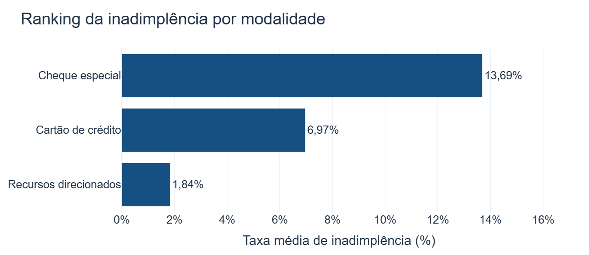
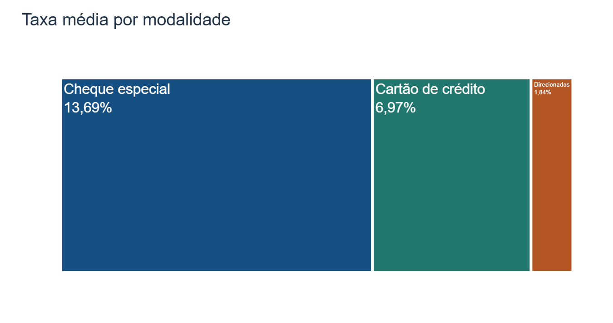
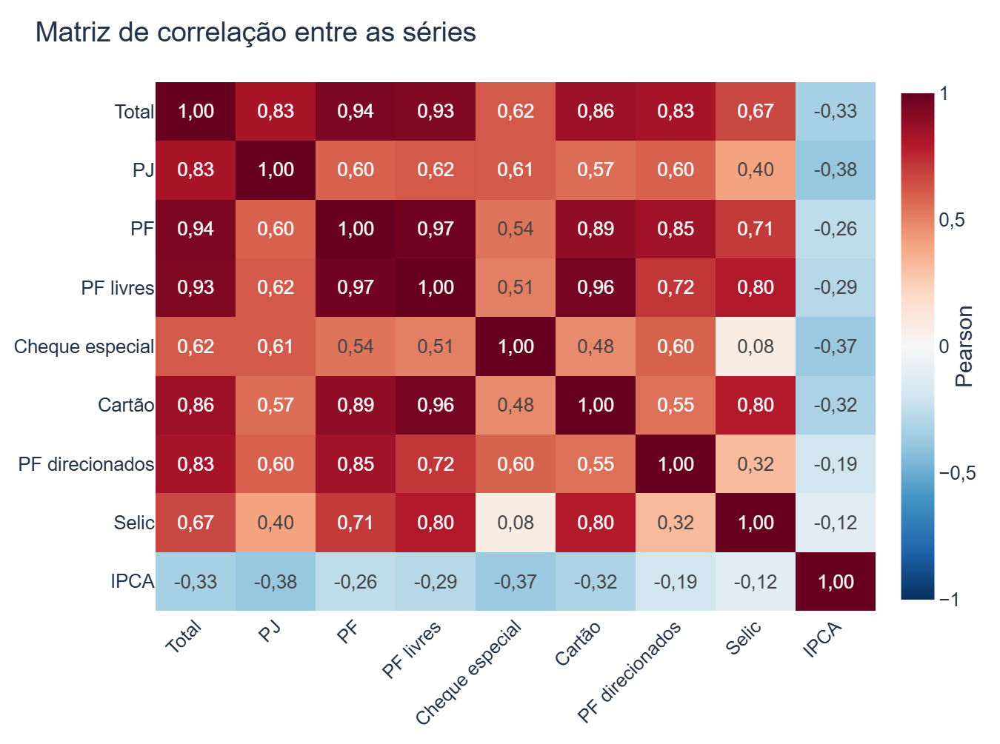

Projeto da disciplina de **Programação Orientada a Objetos**, do curso de **Ciência de Dados e Inteligência Artificial** da PUC-SP. O RadarCrédito reúne séries do Banco Central do Brasil em um painel interativo feito com Python, Pandas, Plotly e Streamlit.

[Abrir o painel no Streamlit](https://radar-credito-9bkrsgposq2fxw9fxmappcm.streamlit.app/) · [Ver o repositório no GitHub](https://github.com/Pau7027/radar-credito)

## Integrantes

| Nº | Nome completo | RA |
| --- | --- | --- |
| 1 | Paulo Enrique Pérez González | 00370839 |
| 2 | Thiago Laurino Silva | 00372259 |
| 3 | Giovana Lordello Guimarães | 00376042 |
| 4 | Gabriel Sousa de Carvalho | 00369956 |
| 5 | Julia Amy Yoshioka | 00370507 |

## Justificativa e objetivos

A inadimplência indica que parte do crédito concedido está com pagamentos atrasados. A taxa total do país pode esconder movimentos diferentes entre famílias e empresas e entre modalidades como o cartão de crédito e o cheque especial. Escolhemos esse tema porque as séries públicas do Banco Central permitem acompanhar essas diferenças ao longo do tempo e investigar sua relação com juros e inflação.

A análise investiga cinco perguntas.

1. Como a inadimplência evoluiu e quando ocorreram os principais picos e vales?
2. Qual modalidade de pessoa física apresentou a maior inadimplência e a maior volatilidade?
3. Altas da Selic antecederam altas da inadimplência? Com quantos meses de defasagem?
4. Como os juros reais e o IPCA se associaram à inadimplência? Qual explicou mais da variação observada na amostra?
5. Pessoas físicas e jurídicas acompanharam o mesmo ciclo?

## Fonte pública e variáveis

Os dados vêm da API do **Sistema Gerenciador de Séries Temporais (SGS)** do Banco Central do Brasil. As séries de crédito medem o percentual do saldo da carteira do Sistema Financeiro Nacional em operações com pelo menos uma parcela em atraso há mais de 90 dias. O aplicativo consulta o intervalo de novembro de 2016 a outubro de 2026. A amostra de crédito usada nos gráficos desta página tem **119 meses**, de novembro de 2016 a setembro de 2026. As séries macroeconômicas começam em novembro de 2015 para dar histórico ao cálculo da inflação acumulada.

| Código SGS | Série | Frequência e unidade |
| --- | --- | --- |
| 21082 | Inadimplência total | Mensal, % da carteira |
| 21083 | Inadimplência de pessoas jurídicas (PJ) | Mensal, % da carteira |
| 21084 | Inadimplência de pessoas físicas (PF) | Mensal, % da carteira |
| 21112 | Inadimplência de PF com recursos livres | Mensal, % da carteira |
| 21113 | Inadimplência de PF no cheque especial | Mensal, % da carteira |
| 21129 | Inadimplência de PF no cartão de crédito | Mensal, % da carteira |
| 21145 | Inadimplência de PF com recursos direcionados | Mensal, % da carteira |
| 432 | Meta da taxa Selic | Diária, % ao ano |
| 433 | Variação do IPCA | Mensal, % no mês |

No formato longo, `data` indica a data de referência, `modalidade` identifica a série e `valor` registra a taxa em escala percentual. Um valor de `5.2` corresponde a **5,2%**. Diferenças entre taxas são expressas em pontos percentuais (p.p.). Nas correlações, os dados ficam em formato largo, com uma linha por mês e uma coluna por série.

## Tratamento e análise dos dados

1. **Coleta.** `FonteBCB` consulta o SGS em blocos, converte datas e valores numéricos com Pandas, ordena as observações e remove datas duplicadas por série. Os CSVs versionados em `data/` servem de cache caso a API falhe.
2. **Exploração.** O notebook verifica tipos, valores ausentes, duplicidades, continuidade mensal e valores fora do intervalo esperado. Na amostra analisada, as sete séries de crédito têm 119 meses consecutivos sem valores ausentes ou duplicidades. A exploração compara média, mediana, mínimo, máximo e desvio padrão.
3. **Alinhamento mensal.** Para a Selic meta, usa-se o último valor disponível de cada mês. A junção por data alinha essa série ao IPCA e à inadimplência. Meses sem observação ficam ausentes e as correlações usam apenas os pares válidos de cada comparação.
4. **Análise.** Filtros selecionam datas e séries. Agrupamentos por modalidade produzem médias para o ranking e o treemap. A matriz usa correlação de Pearson sem defasagem. A dispersão ajusta uma reta por mínimos quadrados após deslocar a Selic pelo número de meses escolhido.

## Arquitetura orientada a objetos

`streamlit_app.py` carrega as séries, instancia os componentes e os passa ao construtor de `Dashboard`. A coleta, o processamento, o cálculo de indicadores e a visualização têm responsabilidades próprias.

| Classe | Responsabilidade |
| --- | --- |
| `FonteDados` | Define o contrato de coleta de uma série temporal. |
| `FonteBCB` | Implementa o contrato para o SGS e gerencia a consulta HTTP e o cache CSV. |
| `AnalisadorDados` | Encapsula o DataFrame e oferece filtros, agrupamento, ordenação, estatísticas e conversão de formato. |
| `Indicador` | Define o contrato `calcular()` e os metadados compartilhados pelas subclasses. |
| `Visualizador` | Gera figuras Plotly com as tabelas processadas. |
| `AnaliseInterpretativa` | Fornece as leituras dos gráficos, os resumos do recorte selecionado e as conclusões. |
| `Dashboard` | Coordena os componentes e exibe filtros, cartões, gráficos e tabela no Streamlit. |

`AnalisadorDados` guarda a tabela em um atributo interno e devolve cópias para consulta. `FonteBCB` herda de `FonteDados`. As subclasses de `Indicador` implementam `calcular()` com lógicas próprias. O painel usa esse contrato para calcular os indicadores dos cartões de forma polimórfica. A injeção dos componentes pelo construtor permite trocar ou ampliar os indicadores sem reescrever a lógica que renderiza os cartões.

## Indicadores desenvolvidos

| Indicador | Cálculo e unidade |
| --- | --- |
| Inadimplência no fim do período | Última taxa disponível até a data final, em %. O cartão mostra a diferença para a observação anterior em p.p. |
| Variação em relação à média de 12 meses | `VariacaoVsMedia12m` subtrai da taxa do mês a média dos 12 meses anteriores. Resultado em p.p. |
| Volatilidade de 12 meses | `Volatilidade12m` calcula o desvio padrão amostral dos últimos 12 meses, incluindo o mês de referência. Resultado em p.p. |
| Z-score histórico | `ZScore` mede a distância da taxa à média do histórico, em desvios padrão. |
| Juros reais ex-post | `JurosReais` aplica a equação de Fisher à meta Selic de fim de mês e ao IPCA acumulado em 12 meses. Resultado em % ao ano. |
| Defasagem da Selic | `DefasagemOtima` testa deslocamentos de 0 a 24 meses e seleciona o que maximiza o valor absoluto da correlação de Pearson. Resultado em meses, acompanhado pelo coeficiente com seu sinal. |

## Gráficos e interpretação

As figuras abaixo foram geradas com os dados versionados. Use o painel Streamlit para explorar recortes diferentes e consultar os valores de cada ponto.

### Evolução da inadimplência

A taxa total caiu de **3,86%** em novembro de 2016 para **2,16%** em dezembro de 2020 e alcançou **5,05%** em agosto de 2026. PF e PJ registraram os seus mínimos em dezembro de 2020. A alta que se seguiu foi mais intensa na carteira de pessoas físicas.

### Ranking das modalidades

O **cheque especial** teve a maior taxa média (13,69%) e o maior desvio padrão histórico em pontos percentuais (1,99 p.p.). Cartão de crédito ficou em segundo lugar na média (6,97%), seguido de recursos direcionados (1,84%). Quando a volatilidade é medida em relação à própria média, os recursos direcionados lideram entre as três modalidades.

### Comparação em treemap

O cheque especial ocupa cerca de 61% da área porque sua taxa média representa essa proporção da soma das três taxas usadas no desenho. As áreas comparam os níveis de inadimplência das modalidades. Uma interpretação em termos de participação na carteira exigiria dados de volume de crédito.

### Mapa de calor de correlações

A correlação no mesmo mês entre inadimplência total e de pessoas físicas foi **0,94**. A taxa de PF faz parte do total, contribuindo para esse resultado. A correlação entre PF e PJ foi **0,60**, compatível com um ciclo em parte comum e trajetórias de intensidades diferentes.

### Dispersão com defasagem da Selic

Cada ponto compara a inadimplência total de um mês à meta Selic observada oito meses antes. Entre as defasagens testadas na amostra, essa produziu a maior correlação para o total (**r = 0,86**, **R² = 0,74**). A defasagem de maior correlação foi de seis meses para PF e 14 para PJ.

### Evolução dos juros reais

Os juros reais ficaram negativos em parte de 2020 a 2022 e atingiram **10,78% ao ano** em fevereiro de 2026. Na comparação de regressões simples da análise interpretativa, os juros reais defasados em seis meses tiveram maior poder explicativo na amostra para inadimplência total (**R² = 0,75**) que o IPCA acumulado em 12 meses (**R² = 0,17**).

## Como usar o dashboard

1. Abra o [RadarCrédito no Streamlit](https://radar-credito-9bkrsgposq2fxw9fxmappcm.streamlit.app/) e escolha o intervalo de datas e as séries na barra lateral.
2. Escolha a série de referência no topo. O primeiro cartão mostra a taxa no fim do período e a variação mensal quando disponível. Os outros três mostram a variação ante a média de 12 meses, a volatilidade e o z-score.
3. Abra **Evolução** para localizar picos e vales. Use **Comparação** para ver as médias por modalidade em barras e treemap.
4. Use **Correlações** para ler a matriz, ajustar a defasagem da Selic e visualizar a série de juros reais.
5. Em **Análise e conclusões**, consulte as respostas às perguntas do projeto. Em **Tabela de dados**, veja as datas, séries e taxas do recorte selecionado.

Os gráficos, os cartões e os resumos do período selecionado acompanham os filtros. As leituras identificadas pelo recorte de novembro de 2016 a setembro de 2026 descrevem a amostra completa.

## Conclusões e limitações

A inadimplência total seguiu uma trajetória de queda e alta, com a aceleração final mais intensa em PF. O cheque especial apresentou a maior inadimplência média e a maior volatilidade em pontos percentuais entre as modalidades comparadas. Selic e juros reais tiveram associação positiva com a inadimplência total na amostra. As diferenças entre PF e PJ aparecem tanto na intensidade da alta quanto nas defasagens observadas.

A amostra abrange essencialmente um ciclo de queda e alta. Tendências em comum, sobreposição das séries e a escolha da defasagem a partir dos próprios dados podem elevar as correlações. A autocorrelação dos resíduos reduz a confiança nos testes das regressões simples. A taxa mede o saldo de operações em atraso e os resultados descrevem associações na amostra. Fatores como endividamento, renda e desemprego ficaram fora do modelo. Os juros reais usam a inflação observada.

## Referências

- Banco Central do Brasil. [Portal de Dados Abertos](https://dadosabertos.bcb.gov.br/) e [metadados da série de inadimplência total (SGS 21082)](https://dadosabertos.bcb.gov.br/dataset/21082-inadimplencia-da-carteira-de-credito---total).
- Banco Central do Brasil. [Meta da taxa Selic (SGS 432)](https://dadosabertos.bcb.gov.br/dataset/432-taxa-de-juros---meta-selic-definida-pelo-copom).
- IBGE. [Índice Nacional de Preços ao Consumidor Amplo (IPCA)](https://www.ibge.gov.br/estatisticas/economicas/precos-e-custos/9256-indice-nacional-de-precos-ao-consumidor-amplo.html).
- RadarCrédito. [Notebook de exploração inicial](https://github.com/Pau7027/radar-credito/blob/main/notebooks/01_exploracao_inicial.ipynb), [dados versionados](https://github.com/Pau7027/radar-credito/tree/main/data) e [análise interpretativa do painel](https://github.com/Pau7027/radar-credito/blob/main/src/analise_interpretativa.py).
